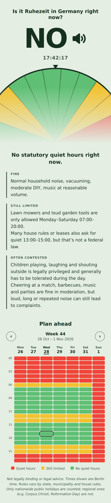
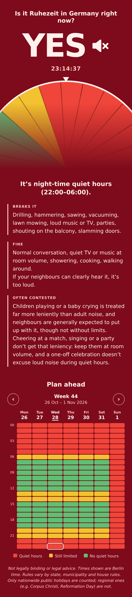

# is-it-ruhezeit-now

# Ist Ruhezeit? / Is it Ruhezeit?

A tiny, dependency-free web page that answers one question: **is it quiet hours (Ruhezeit) in Germany right now?**

It shows a huge **YES** or **NO**, a live clock with seconds, a rotating 24-hour dial, and a short explanation of what does and doesn't break the quiet. It always uses the current time in Germany (`Europe/Berlin`), no matter where the visitor is.

<p>
  
  
  
</p>

> **Not legally binding.** This is an informational tool, not legal advice. See [Limitations](#limitations).

## Two versions

| File | What it does |
|---|---|
| `index.html` | Simple version. Counts night, Sundays and the **nationwide** public holidays. |
| `bundesland.html` | Same page plus a **state picker** (all 16 Bundesländer) that also counts that state's regional holidays. |

Both are a single self-contained HTML file: no build step, no libraries, no network requests, no fonts to load.

## Features

- Live answer based on the real time in Germany, updated every second
- Clock with seconds, aligned to the real second boundary
- Large dial (inspired by the Minecraft clock) that rotates so the current time is always at the top marker. Red slices are quiet hours and green slices are not. It reflects the actual 24-hour window around "now", so Saturday night into Sunday is shown correctly
- Background turns deep red when it's Ruhezeit, pale green when it isn't
- English and German, picked automatically from the browser language
- Explanation split into short labelled blocks: what breaks it, what's fine, and what's often contested (children, cheering, parties)
- Daylight saving is handled automatically, since the time is read through the browser's `Europe/Berlin` time zone
- `bundesland.html` only: the chosen state is remembered in `localStorage` and can be set by link, e.g. `bundesland.html#BY`

## What counts as Ruhezeit

| Rule | Counted as quiet hours |
|---|---|
| Night | 22:00–06:00, every day |
| Sundays | the whole day |
| Public holidays | the whole day |

**Public holidays**

- Nationwide (both versions): New Year, Good Friday, Easter Monday, 1 May, Ascension Day, Whit Monday, 3 October, 25 and 26 December. Easter-based dates are calculated for any year.
- Regional (`bundesland.html` only):

| Holiday | States |
|---|---|
| Epiphany (6 Jan) | BW, BY, ST |
| International Women's Day (8 Mar) | BE, MV |
| Corpus Christi | BW, BY, HE, NW, RP, SL |
| Assumption Day (15 Aug) | BY, SL |
| World Children's Day (20 Sep) | TH |
| Reformation Day (31 Oct) | BB, HB, HH, MV, NI, SN, ST, SH, TH |
| All Saints' Day (1 Nov) | BW, BY, NW, RP, SL |
| Day of Repentance and Prayer (Wednesday before 23 Nov) | SN |

## Deploy on GitHub Pages

1. Put the files in a repository (keep `index.html` in the root).
2. Go to **Settings → Pages**.
3. Under **Build and deployment**, choose **Deploy from a branch**, select your main branch and the `/ (root)` folder, then save.
4. After a minute the site is live at `https://<your-user>.github.io/<repo>/`. The state version is at `.../bundesland.html`.

It also works by just opening the file locally in a browser.

## Repository layout

```
index.html              simple version (deploy this as the main page)
bundesland.html         version with state picker
previews/
  preview-*.html        frozen copies for checking each scenario
  preview-*.png         phone-sized screenshots, handy for sharing
```

## Customising

All text lives in the `TEXT` object near the top of each script, for both languages. Colours are CSS variables at the top of the `<style>` block (`--bg`, `--fg`, `--rest`, `--calm`, and the `body.rest` overrides). The quiet hours themselves are in `reasonAt()` (`h >= 22 || h < 6`).

## Previews and screenshots

Every file in `previews/` is a copy of one of the main pages with one line added before `</head>`, which freezes time, language and (optionally) state:

```html
<script>window.__PREVIEW__ = { iso: "2026-10-28T23:14:37+01:00", lang: "de", state: "BY" };</script>
```

- `iso`: the moment to show, with its UTC offset
- `lang`: `"en"` or `"de"`
- `state`: a state code such as `"BY"` (only used by `bundesland.html`)

When this variable is set, the page renders once and doesn't tick, which makes it easy to screenshot any scenario.

## Limitations

- **Night hours are assumed to be 22:00–06:00 everywhere.** In reality, noise rules are set by state law, municipalities and house rules, and some places differ.
- Some regional holidays only apply in parts of a state (for example Assumption Day in Bavaria). The state version counts them for the whole state.
- Only the two noise-related rules mentioned in the explanation text (garden machines Monday–Saturday 07:00–20:00, and the 13:00–15:00 midday quiet that is mostly a house-rule matter) are included as general hints. Check the exact rules for your municipality and lease.
- The note on children's noise reflects the general legal tendency in Germany to tolerate it, within limits. It is not a guarantee in any individual case.
- Not legal advice. Anything binding should be checked with your local authority (Ordnungsamt), your lease or house rules, or a lawyer.
