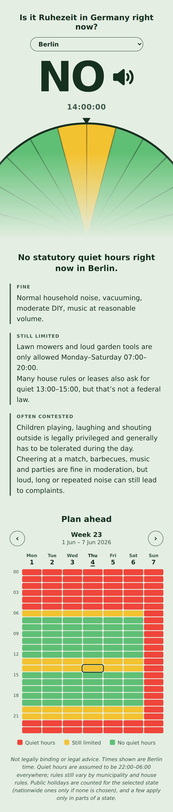
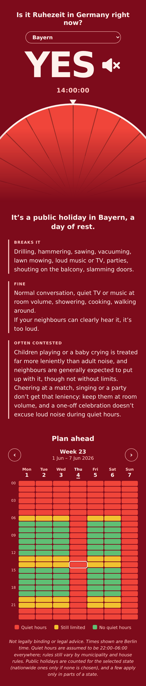

# Ist Ruhezeit? / Is it Ruhezeit?

A tiny, dependency-free web page that answers one question: **is it quiet hours (Ruhezeit) in Germany right now?**

It shows a huge **YES** or **NO**, a live clock with seconds, a rotating 24-hour dial, and a short explanation of what does and doesn't break the quiet. It always uses the current time in Germany (`Europe/Berlin`), no matter where the visitor is.

<p>
  
  
</p>

> **Not legally binding.** This is an informational tool, not legal advice. See [Limitations](#limitations).

## Two versions

| File | What it does |
|---|---|
| `index.html` | The main page, with a **state picker** (all 16 Bundesländer) that also counts that state's regional holidays. |
| `generic.html` | Generic version without a state picker. Counts night, Sundays and the **nationwide** public holidays only. |

Both are a single self-contained HTML file: no build step, no libraries, no network requests, no fonts to load.

## Features

- Live answer based on the real time in Germany, updated every second
- Clock with seconds, aligned to the real second boundary
- A speaker icon next to the answer: muted for YES, with sound waves for NO, so the answer is clear at a glance
- Large dial (inspired by the Minecraft clock) that rotates so the current time is always at the top marker. Red slices are quiet hours and green slices are not. It reflects the actual 24-hour window around "now", so Saturday night into Sunday is shown correctly
- Week view below the explanation, titled "Plan ahead": a 7-day by 24-hour grid (Monday to Sunday, with the ISO week number) showing for every hour whether it is quiet hours (red), still limited (yellow) or fine (green). The current hour is outlined, and you can step to the previous or next week to check upcoming holidays
- Background turns deep red when it's Ruhezeit, pale green when it isn't
- English and German, picked automatically from the browser language
- Explanation split into short labelled blocks: what breaks it, what's fine, and what's often contested (children, cheering, parties)
- Daylight saving is handled automatically, since the time is read through the browser's `Europe/Berlin` time zone
- `index.html` only: the chosen state is remembered in `localStorage` and can be set by link, e.g. `https://<your-user>.github.io/<repo>/#BY`

## What counts as Ruhezeit

| Rule | Counted as quiet hours |
|---|---|
| Night | 22:00–06:00, every day |
| Sundays | the whole day |
| Public holidays | the whole day |

Shown in **yellow** on the dial and in the week view (not quiet hours, but limited, matching the "Still limited" note on the page): 13:00–15:00 for the midday quiet that many house rules and leases ask for, and 06:00–07:00 and 20:00–22:00 when lawn mowers and loud garden tools are off-limits. These are general hints, not statutory quiet hours.

**Public holidays**

- Nationwide (both versions): New Year, Good Friday, Easter Monday, 1 May, Ascension Day, Whit Monday, 3 October, 25 and 26 December. Easter-based dates are calculated for any year.
- Regional (`index.html` only):

| Holiday | States |
|---|---|
| Epiphany (6 Jan) | BW, BY, ST |
| International Women's Day (8 Mar) | BE, MV |
| Corpus Christi | BW, BY, HE, NW, RP, SL |
| Assumption Day (15 Aug) | BY, SL |
| World Children's Day (20 Sep) | TH |
| Reformation Day (31 Oct) | BB, HB, HH, MV, NI, SN, ST, SH, TH |
| All Saints' Day (1 Nov) | BW, BY, NW, RP, SL |
| Day of Repentance and Prayer (Wednesday before 23 Nov) | SN |

## Deploy on GitHub Pages

1. Put the files in a repository (keep `index.html` in the root).
2. Go to **Settings → Pages**.
3. Under **Build and deployment**, choose **Deploy from a branch**, select your main branch and the `/ (root)` folder, then save.
4. After a minute the site is live at `https://<your-user>.github.io/<repo>/`. The generic version without the state picker is at `.../generic.html`.

It also works by just opening the file locally in a browser.

## Repository layout

```
index.html              main page, with state picker
generic.html            generic version, nationwide holidays only
previews/
  preview-bundesland-*  phone-sized screenshots of index.html
  preview-yes/no-*      phone-sized screenshots of generic.html
```

## Customising

All text lives in the `TEXT` object near the top of each script, for both languages. Colours are CSS variables at the top of the `<style>` block (`--bg`, `--fg`, `--rest`, `--calm`, and the `body.rest` overrides). The quiet hours themselves are in `reasonAt()` (`h >= 22 || h < 6`).

## Screenshots

The images in `previews/` are phone-sized screenshots of the page in each scenario. To capture a specific moment yourself, add this line before `</head>` in a local copy of either page. It freezes time, language and (for `index.html`) state:

```html
<script>window.__PREVIEW__ = { iso: "2026-10-28T23:14:37+01:00", lang: "de", state: "BY" };</script>
```

- `iso`: the moment to show, with its UTC offset
- `lang`: `"en"` or `"de"`
- `state`: a state code such as `"BY"` (only used by `index.html`)

## Limitations

- **Night hours are assumed to be 22:00–06:00 everywhere.** In reality, noise rules are set by state law, municipalities and house rules, and some places differ.
- Some regional holidays only apply in parts of a state (for example Assumption Day in Bavaria). The main page counts them for the whole state.
- Only the two noise-related rules mentioned in the explanation text (garden machines Monday–Saturday 07:00–20:00, and the 13:00–15:00 midday quiet that is mostly a house-rule matter) are included as general hints. Check the exact rules for your municipality and lease.
- The note on children's noise reflects the general legal tendency in Germany to tolerate it, within limits. It is not a guarantee in any individual case.
- Not legal advice. Anything binding should be checked with your local authority (Ordnungsamt), your lease or house rules, or a lawyer.
